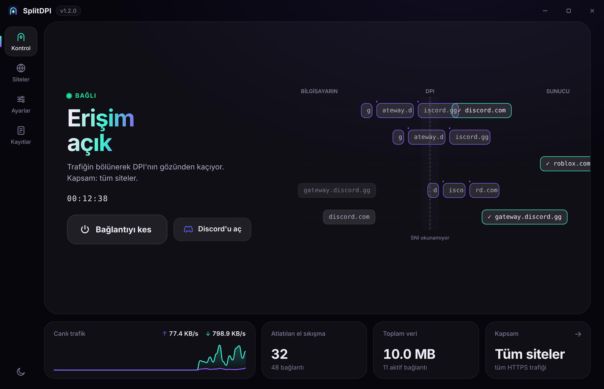
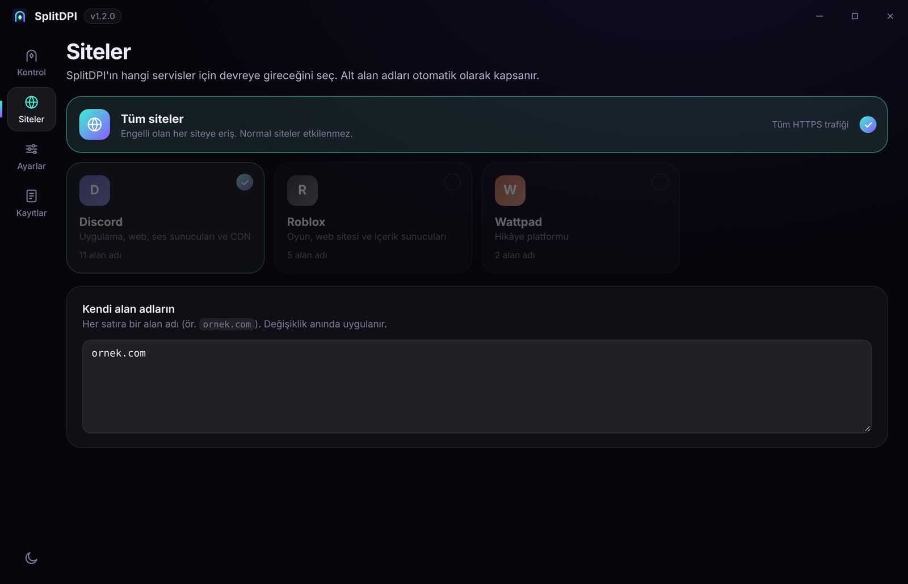
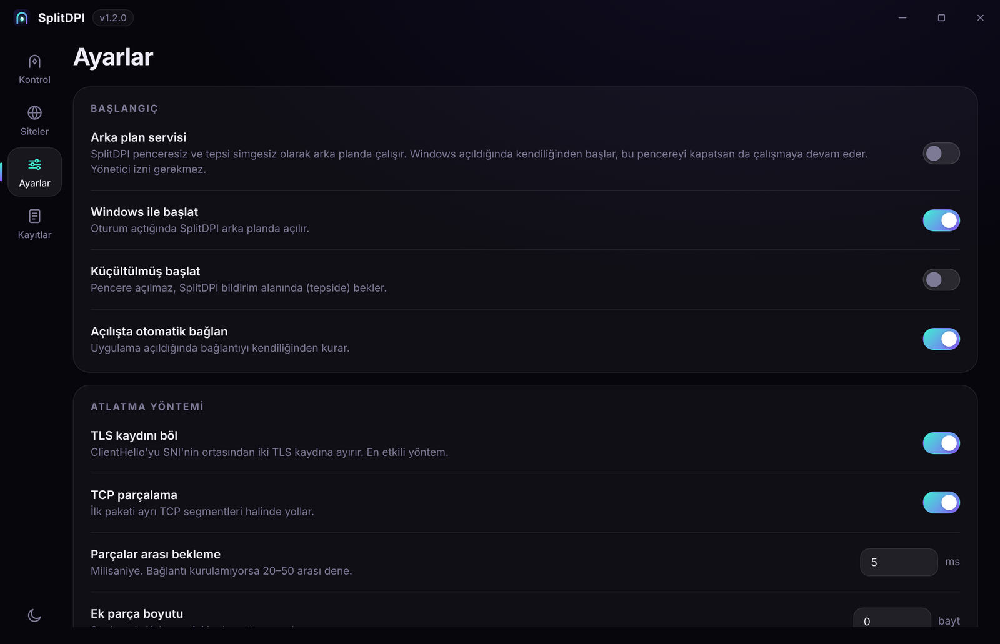

<div align="center">


# SplitDPI

**DPI ile engellenen sitelere erişim için Windows uygulaması.**
Trafiği bilgisayarında böler. Uzak sunucu, VPN ya da sürücü kullanmaz.

[](https://github.com/YigitSezenn/SplitDPI/releases/latest)
[](LICENSE)
[](#gereksinimler)

[**İndir**](https://github.com/YigitSezenn/SplitDPI/releases/latest) · [Nasıl çalışır](#nasıl-çalışır) · [Sorun giderme](#sorun-giderme) · [Kaynaktan derleme](#kaynaktan-derleme) · [English](#english)



</div>

---

## Neden SplitDPI?

Türkiye'deki internet sağlayıcıları Discord, Roblox ve Wattpad gibi servisleri **Derin Paket İnceleme** (DPI) ile engelliyor. Bu tür engeller trafiğin içeriğini değil, bağlantının başında açıkça gönderilen site adını okur. SplitDPI bu site adını, DPI sisteminin tanıyamayacağı ama hedef sunucunun sorunsuz birleştirdiği parçalara böler.

- **Trafiğin senin bilgisayarında kalır.** Arada bir VPN sunucusu ya da üçüncü taraf yoktur, hız kaybı olmaz.
- **Sürücü ve yönetici izni gerekmez.** Kurulum ve kullanım normal kullanıcı hesabıyla yapılır.
- **Hiçbir şey göndermez.** Telemetri, hesap, reklam ya da güncelleme sunucusu yoktur.
- **Açık kaynak.** Tüm kod bu depodadır, MIT lisansıyla dağıtılır.

## Kurulum

1. [Sürümler](https://github.com/YigitSezenn/SplitDPI/releases/latest) sayfasından `SplitDPI-Setup-x.y.z.exe` dosyasını indir.
2. Çalıştır ve adımları izle. Uygulama `%LOCALAPPDATA%\Programs\SplitDPI` klasörüne kurulur.
3. SplitDPI'ı aç ve **Bağlan**'a bas.

> **Windows SmartScreen uyarısı:** Kurulum dosyası dijital olarak imzalı olmadığı için Windows "Bilgisayarınız korundu" uyarısı gösterebilir. **Ek bilgi → Yine de çalıştır** ile devam edebilirsin. İndirdiğin dosyanın değiştirilmediğini, sürüm notlarındaki SHA-256 değeriyle karşılaştırarak doğrulayabilirsin:
>
> ```powershell
> Get-FileHash .\SplitDPI-Setup-1.2.0.exe -Algorithm SHA256
> ```

Önceki adıyla (Geçit) kurulmuş bir sürüm varsa kurulum dosyası onu otomatik olarak kaldırır ve ayarlarını taşır.

### Gereksinimler

- Windows 10 (1809 ve üstü) veya Windows 11, 64 bit
- Yaklaşık 250 MB disk alanı

## Kullanım

| Ekran | |
|---|---|
| **Kontrol** | Bağlan / bağlantıyı kes. Canlı trafik grafiği, atlatılan bağlantı sayısı ve oturum süresi. |
| **Siteler** | Hangi servisler için devreye gireceğini seç: tüm siteler, Discord, Roblox, Wattpad ya da kendi eklediğin alan adları. |
| **Ayarlar** | Başlangıç davranışı, bölme yöntemi, DNS sağlayıcısı, port ve tema. |
| **Kayıtlar** | Hangi bağlantının bölündüğünü ve oluşan hataları gösterir. |

<p align="center">
  
  
</p>

**Discord'u aç** düğmesi Discord'u kapatıp SplitDPI üzerinden yeniden başlatır. Sistem proxy'si ayarı kapalıyken de çalışır. Bu durumda yalnızca Discord SplitDPI'dan geçer.

### Arka plan servisi

**Ayarlar → Başlangıç → Arka plan servisi** açıldığında SplitDPI penceresiz ve tepsi simgesi olmadan çalışır. Windows açılırken kendiliğinden başlar, pencereyi kapatsan da çalışmaya devam eder. Uygulamayı açtığında servisin durumunu ve istatistiklerini görürsün, oradan durdurabilirsin.

Servis istemiyorsan **Windows ile başlat**, **Küçültülmüş başlat** ve **Açılışta otomatik bağlan** seçeneklerini birlikte kullanarak SplitDPI'ın tepside sessizce çalışmasını sağlayabilirsin.

## Nasıl çalışır?

Bir HTTPS bağlantısı kurulurken tarayıcının gönderdiği ilk paket (TLS *ClientHello*), bağlanılan sitenin adını **SNI** alanında şifresiz taşır. DPI sistemi bu paketi okur, adı kara listede bulursa bağlantıyı keser.

SplitDPI, bilgisayarında `127.0.0.1:8881` adresinde çalışan bir yerel proxy'dir. Engellenen bir siteye bağlanırken:

```
 Normal:        [ ClientHello ............ sni=gateway.discord.gg ............ ]   → DPI adı okur, keser

 SplitDPI:      [ TLS kaydı 1 ... sni=gateway.di ]  [ TLS kaydı 2  scord.gg ... ]
                 └─ TCP 1 ─┘└──── TCP 2 ────┘└─────────── TCP 3 ───────────┘   → DPI adı bulamaz
                                                                                   sunucu sorunsuz birleştirir
```

1. **TLS kaydı bölme:** ClientHello, site adının tam ortasından iki ayrı TLS kaydına ayrılır. TLS standardı bunu açıkça destekler, bu yüzden sunucu iki kaydı sorunsuz birleştirir. DPI ise tek bir kayıtta tam bir alan adı göremez.
2. **TCP parçalama:** Bölünmüş veri, aralarında birkaç milisaniye bekleyerek ayrı TCP segmentleri halinde gönderilir.
3. **DNS-over-HTTPS:** Alan adları sağlayıcının DNS'i yerine Cloudflare (`1.1.1.1`) ya da Google (`8.8.8.8`) üzerinden şifreli olarak çözülür. Bağlantı doğrudan IP adresine kurulur, böylece DNS tabanlı engeller de aşılır.

Bağlantının geri kalanı olduğu gibi aktarılır. SplitDPI şifreli trafiği çözmez, içeriği okumaz ve değiştirmez.

## Sorun giderme

**Bağlanıyor ama site açılmıyor.**
**Ayarlar → Parçalar arası bekleme** değerini 20–50 ms'ye çıkar. Bazı sağlayıcılar parçaları kısa süre içinde birleştirip inceler.

**"Çözülemedi" uyarıları görüyorum.**
Bunlar genellikle hiç DNS kaydı olmayan telemetri adresleridir (ör. `*.dc-telemetry.net`) ve zararsızdır. Sürekli tekrar ediyorsa DoH sağlayıcısını değiştir.

**Bazı siteler hâlâ açılmıyor.**
Bazı siteler alan adıyla değil, doğrudan IP adresiyle engellenir. Bu tür engelleri SplitDPI gibi yerel araçlar aşamaz, VPN gerekir. Kayıtlar ekranında site "parça" olarak görünüyor ama bağlantı zaman aşımına uğruyorsa sebep büyük ihtimalle budur.

**Discord sesli kanala bağlanmıyor.**
Discord ses için UDP kullanır ve UDP proxy'den geçmez. Türkiye'de ses trafiği genellikle engelli değildir, ama sağlayıcın engelliyorsa SplitDPI tek başına yeterli olmaz.

**SplitDPI kapandıktan sonra internetim gitti.**
Bu normalde olmaz: SplitDPI kapanırken proxy ayarını geri alır, beklenmedik bir kapanmanın ardından da bir sonraki açılışta ayarı düzeltir. Elle düzeltmek için **Windows Ayarları → Ağ ve İnternet → Proxy → Proxy sunucusu kullan** seçeneğini kapat.

**WSL "Http Proxy değişikliği algılandı" bildirimi gösteriyor.**
WSL, Windows proxy ayarını izler. WSL kullanmıyorsan görmezden gelebilirsin. Bildirimi kapatmak için `%USERPROFILE%\.wslconfig` dosyasına şunu ekle:
```ini
[wsl2]
autoProxy=false
```

**Oyunlar ve hile koruma sistemleri.**
SplitDPI sürücü yüklemez, başka süreçlere müdahale etmez, oyun dosyalarına dokunmaz. Yaptığı şey Windows proxy ayarını değiştirmektir. Oyun içi trafik genellikle UDP olduğundan SplitDPI'dan geçmez.

## Güvenlik ve gizlilik

- Proxy yalnızca `127.0.0.1` adresini dinler, ağdaki başka cihazlar erişemez.
- Tarayıcıdaki sayfaların proxy'yi kötüye kullanmasına (DNS rebinding) karşı yalnızca geçerli `CONNECT` ve mutlak `http://` istekleri kabul edilir.
- Arayüz sandbox içinde ve sıkı bir içerik güvenlik politikasıyla (CSP) çalışır. Yeni pencere açma, dış sayfaya gitme ve tarayıcı izinleri kapalıdır.
- Paketlenmiş uygulamada Electron'un `RunAsNode`, `NODE_OPTIONS` ve `--inspect` özellikleri [fuse](https://www.electronjs.org/docs/latest/tutorial/fuses) ile kalıcı olarak kapatılmıştır. Uygulama yalnızca kendi paketinden kod yükler.
- Arayüzden gelen tüm ayarlar ana süreçte doğrulanır.
- Uygulama hiçbir veri toplamaz ve dışarıya göndermez. Bağlandığı tek dış adres, ayarladığın DoH sağlayıcısıdır.

Bir güvenlik açığı bulursan lütfen herkese açık bir issue açmak yerine [SECURITY.md](SECURITY.md) belgesindeki adımları izle.

## Kaynaktan derleme

Gereksinimler: [Node.js](https://nodejs.org) 20+, kurulum dosyası için [NSIS 3](https://nsis.sourceforge.io).

```powershell
git clone https://github.com/YigitSezenn/SplitDPI.git
cd SplitDPI
npm install
npm start          # geliştirme modunda çalıştır
npm test           # motor testleri
npm run dist       # dist\SplitDPI-Setup-<sürüm>.exe
```

> Yeni npm sürümleri paketlerin kurulum betiklerini varsayılan olarak engeller. Electron'un kendi dosyalarını indirebilmesi için `package.json` içindeki `allowScripts` alanı bu izni verir. Kurulum yarıda kalırsa `node node_modules/electron/install.js` komutunu çalıştır.

### Proje yapısı

```
engine/
  tls.js        ClientHello ayrıştırma, SNI bulma, TLS kaydı ve TCP bölme
  proxy.js      Yerel HTTP CONNECT proxy'si
  doh.js        DNS-over-HTTPS çözücü (önbellekli)
  presets.js    Hazır servis listeleri
  system.js     Windows sistem proxy'si, Discord başlatıcı
renderer/       Arayüz (HTML, CSS, paket akışı animasyonu)
main.js         Ana süreç: pencere, tepsi, arka plan servisi, ayarlar
build/          Kurulum betiği (NSIS) ve paketleme kancası
test/           Motor testleri
```

## Katkıda bulunma

Hata bildirimleri ve öneriler için [issue](https://github.com/YigitSezenn/SplitDPI/issues) açabilirsin. Bağlantı sorunlarını bildirirken internet sağlayıcını ve Kayıtlar ekranındaki ilgili satırları eklemen, sorunu çok daha hızlı bulmamı sağlar.

## Yasal not

SplitDPI, internet trafiğini şifrelemeyen ve yönlendirmeyen, yalnızca bilgisayarındaki bağlantıların biçimini değiştiren bir araçtır. Kullanımından doğacak sorumluluk kullanıcıya aittir. Bulunduğun ülkenin yasalarına uymak senin sorumluluğundadır.

## Lisans

[MIT](LICENSE) © Süleyman Yiğit Sezen

---

## English

**SplitDPI** is a Windows app that restores access to sites blocked by Deep Packet Inspection (DPI), with a focus on Turkey (Discord, Roblox, Wattpad and others). It runs a local proxy on `127.0.0.1` that splits the TLS ClientHello into two TLS records and multiple TCP segments right in the middle of the SNI hostname, and resolves names over DNS-over-HTTPS. No remote server, no VPN, no kernel driver, no admin rights, no telemetry.

Download the installer from [Releases](https://github.com/YigitSezenn/SplitDPI/releases/latest). To build from source: `npm install && npm run dist` (requires Node.js 20+ and NSIS 3). Licensed under MIT.
